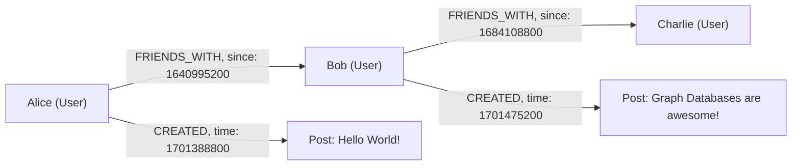

# Graph Databases in Plain English

A **graph database** stores data as **nodes** and **relationships** instead of tables and rows. It is built for one job: answering questions about how things connect.

## The building blocks

- **Node**: a single entity, such as a person, a product, or a document.
  - Each node can have one or more **labels** that describe its type, like `:Person` or `:Post`.
  - Each node holds **properties**: key-value pairs like `name: "Alice"` or `age: 33`.
- **Relationship**: a directed connection between two nodes.
  - Every relationship has a **type**, like `:FRIENDS_WITH` or `:CREATED`.
  - Relationships can have properties too, like `since: 1640995200`.
  - Direction matters: `(Alice)-[:CREATED]->(post1)` reads "Alice created post1".
- Together, nodes and relationships form a **graph**. Labels plus properties make it a **property graph model**, the model FalkorDB uses.

```cypher
(alice:User {name: "Alice"})-[:FRIENDS_WITH {since: 1640995200}]->(bob:User {name: "Bob"})
```



## Why not just use SQL?

- **Connection questions are natural in graphs**: "Which accounts are linked to this flagged transaction?" or "What breaks if this service goes down?"
- **In SQL**, each question needs JOINs, and every extra hop adds another JOIN.
- **In a graph**, relationships are stored directly, so one query walks the whole path.
- **Relationships are first-class data**, not an afterthought bolted onto rows.

- **The classic test**: "Who directed the sci-fi movie where the lead actor was also in The Revenant?"
  - A vector search can find documents about The Revenant but fails to connect the actor to other movies and then to directors.
  - A graph follows actor to movies to directors step by step, and can show that path.

## What graphs are used for

- **GraphRAG**: retrieval for AI that follows relationships between facts.
- **Agent memory**: a store of what an agent learned, kept between sessions.
- **Fraud detection**: find linked accounts and transactions.
- **Recommendations and social networks**: friends, likes, purchases.
- **Security and network analysis**: how an attack could spread.
- **Company knowledge**: connect people, teams, projects, and decisions.
- **Real-time apps**: low-latency lookups inside interactive user flows.

A graph stores the relationships directly, so an agent follows them in one query instead of stitching records together at every step. That single idea is why FalkorDB is the context layer for this hackathon.

## Graph terms you will see

- **Traversal**: walking from node to node along relationships.
- **Hop**: one step across one relationship. "Multi-hop" means several steps.
- **Schema**: in a graph, the schema lives in the data itself as labels and relationship types.
- **Path**: the full route from one node to another, useful for explanations.
- **Pattern**: the shape you search for, written with parentheses and arrows in Cypher.
