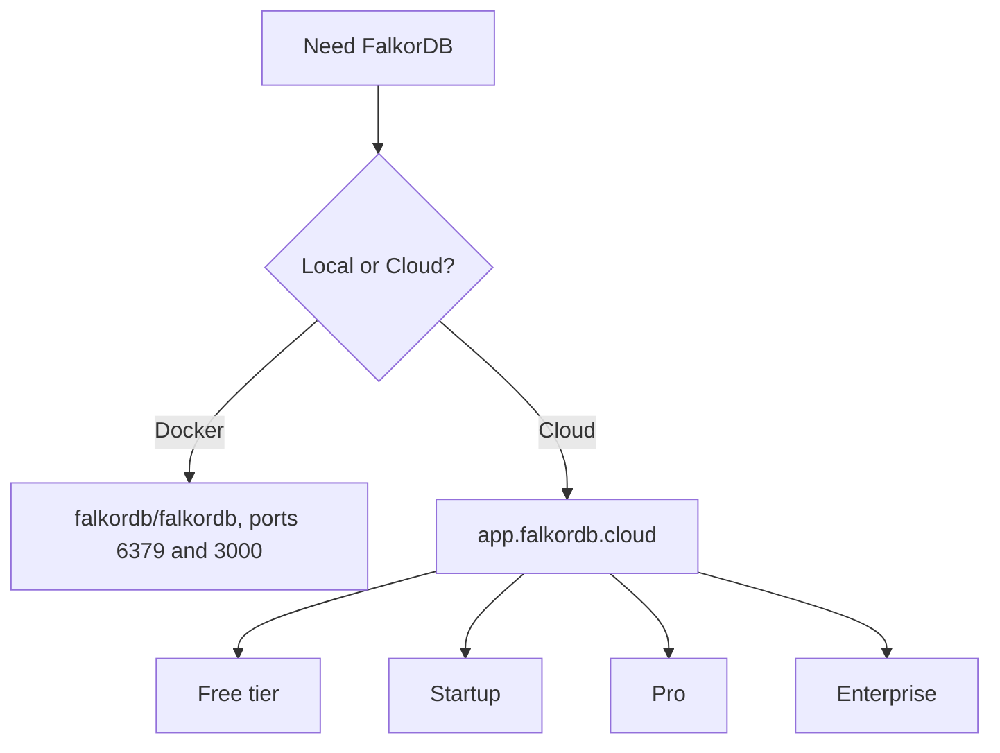

# Running FalkorDB

Two ways to get FalkorDB: **Docker locally** or **FalkorDB Cloud**. Both work for the hackathon. Docker is fastest because there is no signup.

## Docker quick start

- One command starts the server and the Browser:

```bash
docker run -p 6379:6379 -p 3000:3000 -it --rm falkordb/falkordb:latest
```

- **Port 6379**: the FalkorDB server, where your app connects.
- **Port 3000**: the FalkorDB Browser UI, open at `http://localhost:3000`.
- Persist data so it survives container restarts:

```bash
docker run -p 6379:6379 -p 3000:3000 -it --rm -v ./data:/var/lib/falkordb/data falkordb/falkordb
```

- Add a password:

```bash
docker run -p 6379:6379 -p 3000:3000 -it \
  -e REDIS_ARGS="--requirepass yourpassword" \
  --rm falkordb/falkordb:latest
```

## The three Docker images



- **falkordb/falkordb** - server plus Browser. Use it for development and exploration (ports 6379, 3000).
- **falkordb/falkordb-server** - server only. Lighter; use it for production (port 6379).
- **falkordb/falkordb-browser** - Browser only. Needs `FALKORDB_URL` pointing at a server (port 3000).

## Docker Compose

- For multiple services, use a `docker-compose.yml`:

```yaml
services:
  falkordb:
    image: falkordb/falkordb:latest
    container_name: falkordb
    ports:
      - "6379:6379"
      - "3000:3000"
    environment:
      - REDIS_ARGS=--requirepass falkordb
      - FALKORDB_ARGS=THREAD_COUNT 4
    restart: unless-stopped
```

- Common commands:

```bash
docker-compose up -d                        # start
docker-compose logs -f                      # follow logs
docker-compose down                         # stop and remove containers
docker-compose exec falkordb redis-cli      # open a shell inside
```

- Configuration goes through two environment variables.
  - `REDIS_ARGS` - Redis options such as `--requirepass`, `--appendonly yes`, `--maxmemory 2gb`.
  - `FALKORDB_ARGS` - FalkorDB options such as `THREAD_COUNT 8 CACHE_SIZE 50 TIMEOUT_MAX 60000`.

## FalkorDB Cloud

- Sign up at `app.falkordb.cloud`, then click create to spin up an instance.
- The **Free tier** is the default, and upgrading later is simple.
- **Startup**: pick your cloud provider and region.
- **Pro**: set up payment first, then choose **replication or cluster**, each **single-zone or multi-zone**. Multi-zone spreads replicas across at least two zones. Up to two replicas are supported, plus node types and instance credentials.
- **Enterprise**: choose a **public or private network**; a custom network must be created before the instance.
- Self-hosting note: FalkorDB needs **Redis 8.0.0 or later**. Earlier versions, including 7.x, are not supported.

## The Browser

- Web UI at port 3000 for exploring, querying, and managing graphs.
- **Cypher editor** with autocomplete and syntax highlighting.
- **Graphs manager**: create, delete, duplicate, and export graphs (downloads a `.dump`), or upload data.
- Built-in **REST API docs** at `/docs` (Swagger, with "Try it out").
- Connection URL formats: `falkor://`, `falkors://`, `redis://`, `rediss://`.

For development, run the Docker image and keep the Browser open in a tab. Watching nodes appear as your agent writes them is the fastest way to debug your graph model.
