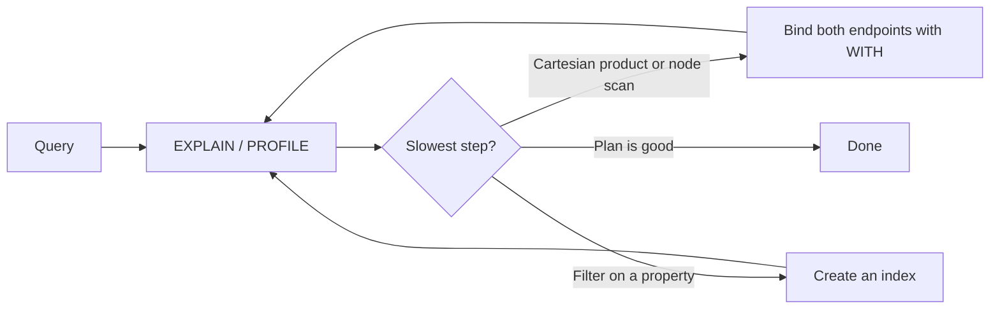

# Writing Good Cypher

Fast queries matter when an agent runs against the graph on every step. Three things get beginners most of the way: **reading the plan first**, **doing shared work once**, and **indexing what you filter**.

## Look at the plan first

- **EXPLAIN** shows the execution plan without running the query.
- **PROFILE** runs the query and reports, per operation, how many records it produced and how much time it spent.
- Several different plans can produce the same result with very different performance. Read the plan, then fix the slowest step.



## A worked example (with numbers)

- Scenario: find flights from Salt Lake to Tampa in a flight graph.
- Baseline query on a development machine: mean latency **13.7 ms**, about **120 queries per second**.
- **Step 1 - bind each node once**: a `WITH` clause acts as a barrier, telling the planner to find both endpoints before traversing.

```cypher
MATCH (s:Airport {name:'Salt Lake'}), (t:Airport {name:'Tampa'})
WITH s, t
MATCH p = (s)-[:flies_to*]->(t)
RETURN p
LIMIT 5
```

- Without the barrier, the planner may scan one node, combine with a **Cartesian product**, and only then expand - multiplying rows for no reason.
- **Step 2 - index what you filter**: create an index on the attribute you match on.

```cypher
CREATE INDEX FOR (a:Airport) ON (a.name)
```

  - The plan changes from "label scan plus filter" to an **index seek**.
  - Finding the two airports by name dropped well **below 1 ms**.
- **Step 3 - verify**: re-run PROFILE after every change. Optimize what the numbers show, not what you guess.

## Rules of thumb

- **Filter early**: reduce rows before expanding patterns.
- **Index the properties** you filter on most (range index).
- **Avoid Cartesian products**: they explode as row counts multiply.
- **Give the planner more of the pattern**: more fixed labels and properties means a better plan.
- **Keep traversals intentional**: every extra hop multiplies work.
- **Reuse plans for repeated shapes** during an agent run; caching helps at the client level.

## Extend the engine with UDFs

- **UDFs** are user-defined functions, a feature added to FalkorDB, written in **JavaScript**.
- Functions are grouped into a **UDF library** that you load once.
- Example library `collection utils` provides `intersect`, `union`, `shuffle`, and `zip`.
- Use them for logic too specific for built-in functions, such as custom text handling or math inside the database.

When your agent loop gets slow, do not rewrite the agent first. Run PROFILE, add the right index, and rebind the pattern. Most "slow graph" problems are fixable in the query itself.
