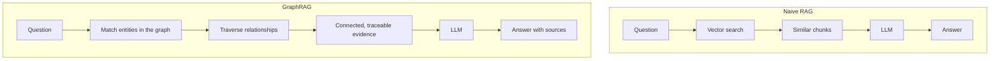

# RAG and GraphRAG

**RAG** (retrieval-augmented generation) feeds an LLM relevant facts so its answers stay grounded. **GraphRAG** replaces flat document lookup with a knowledge graph. This file covers the prerequisites first, then the method.

## Prerequisites: embeddings and vector search

- **Embedding**: a model turns text into a list of numbers (a vector) that captures meaning.
  - Example: 1024 numbers standing for one chunk of text.
  - Similar meanings end up close together in "vector space".
- **Vector search**: find the vectors nearest to the question's vector - approximate nearest neighbor (ANN) search.
- **Keyword search**: exact matches, often scored with BM25.
- The core weakness: vector search fetches chunks **similar to the question**, not chunks that are logically connected to it.

## What RAG does

- **Retriever**: fetch relevant information from a knowledge source such as a database or a document set.
- **Generator**: an LLM writes an answer using that retrieved information as context.
- **The promise**: factual, accurate responses with fewer hallucinations. RAG was first coined in a 2020 paper and is now a standard architectural pattern.

## Where naive RAG breaks

- **Classic example**: "Who directed the sci-fi movie where the lead actor was also in The Revenant?"
  - Naive RAG retrieves documents about The Revenant, finds the cast, and stops.
  - It cannot hop from the actor to other movies, and from those movies to the director.
- **The failure is retrieval, not the model**: the model is asked to answer from context that never contained the answer.
- **Scale**: a 2026 industry analysis found **72% to 80% of enterprise RAG implementations fail to reach production**.
- **Root causes**: inaccurate retrieval, limited context understanding, hallucination, and the cost of large vector stores.

- The two pipelines side by side:

## What GraphRAG is

- **Definition**: a retrieval-augmented generation approach that combines **knowledge graphs** with LLMs.
  - The graph stores entities, relationships, source facts, and provenance.
  - The retriever follows those connections to assemble relevant, traceable context.
  - The LLM generates an answer grounded in that evidence.
- **Pipeline steps**:
  - Ingest raw documents and split them into chunks.
  - Extract entities and relationships with an LLM plus an embedding model.
  - Build the graph: entities become nodes, relations become edges.
  - At query time, match the question to the graph, traverse, and generate.
- **Benefits**:
  - Multi-hop reasoning that vector similarity alone misses.
  - Explainable, verifiable answers with a trail back to sources.
  - Often far fewer tokens: studies measured **26% to 97% fewer tokens** for response generation.

## Types and when to use it

- **Static graph**: built once; good for stable corpora.
- **Dynamic graph**: updates as new data arrives.
- **Hybrid**: a stable core graph plus dynamic updates.
- **Vector RAG + GraphRAG hybrid**: vector search retrieves candidates, then graph reasoning refines them.
- **Multi-GraphRAG**: several graphs handle different aspects of a query.
- **Use GraphRAG when**: queries need multi-hop reasoning, factual accuracy matters, deep context is required, or the knowledge base is large.
- **Note**: Microsoft's open-source system is also named GraphRAG; the term describes the pattern more than one product.

Every agent decision in this hackathon is a retrieval problem. A graph lets you retrieve the way a human does: follow the relationships, keep the evidence, and show your work.
