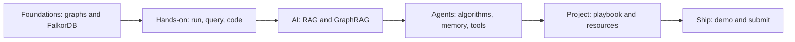

# Start Here

This folder is a short course on **graph databases** and **FalkorDB**, the database powering the **Graph Hacks: Context for AI Agents** hackathon. Each file takes 2-3 minutes to read. Read them in order if graph databases are new to you.

## What you are building

- **The challenge**: build a working agent, or a group of agents, with **FalkorDB as its context layer**.
- **The rule**: the graph must shape what the agent does. It cannot sit on the side.
- **Agent problems today**: they see pieces, not the whole picture; lose earlier sessions; miss how things relate; cannot explain choices.
- **The fix**: put the agent's context in a graph. Data, memory, and knowledge become nodes and edges the agent can follow.
- **Event**: October 15 (12:01 AM) to October 18 (11:59 PM) IST, online, free to enter.
- **Teams**: solo or up to 4 people. **Prizes**: $20,000 total across 3 tracks.

## The reading order

- **Foundations**
  - `01-graph-databases.md` - nodes, edges, and why connections matter.
  - `02-falkordb.md` - what FalkorDB is and how it works.
- **Hands-on basics**
  - `03-run-falkordb.md` - Docker, Docker Compose, Cloud, and the Browser.
  - `04-cypher-basics.md` - the query language, from CREATE to MATCH.
  - `05-python-client.md` - connect, query, and bulk-load from Python.
  - `06-writing-good-cypher.md` - PROFILE, indexes, and UDFs.
- **AI concepts**
  - `07-rag-and-graphrag.md` - embeddings, RAG, and why graphs fix retrieval.
  - `08-graphrag-sdk.md` - ingest documents and get cited answers.
- **Agent patterns**
  - `09-graph-algorithms.md` - PageRank, shortest path, and more as agent tools.
  - `10-agent-memory.md` - memory across sessions and between agents.
- **Project work**
  - `11-hackathon-playbook.md` - tracks, rules, and a build checklist.
  - `12-resources-map.md` - every saved resource and where it lives.
- **Build and ship**
  - `13-agent-tools-and-mcp.md` - a fixed tool catalogue, validation, and MCP.
  - `14-demo-and-submission.md` - judges, demo moves, and the submission pack.
  - `15-building-from-scratch.md` - a blueprint, division, and systems approach to any build.

## How to use this guide

- **Time**: 2-3 minutes per file. Skim the bullets on a second pass.
- **Method**: run every command in a code block. Learning happens in the terminal.
- **Location**: this guide is `Documents/guide/`, next to the raw resources in `Documents/Hackathon-resources/` and the working folder `project-notes/`.
- **Event extras**: the event's Rules, Resources, and Submit pages, plus the WeMakeDevs tutorial "How to Build an Agent That Reasons Over a Graph", are saved in `Documents/Hackathon-resources/` and processed in `automated-notes/`.
