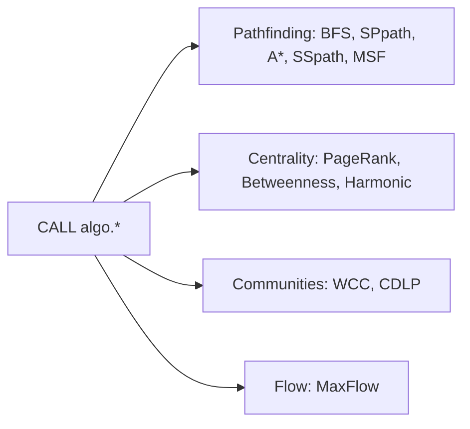
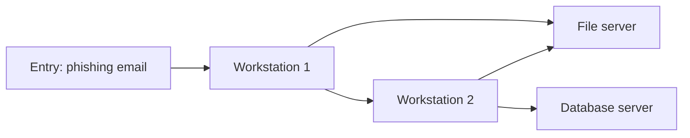

# Graph Algorithms as Agent Tools

FalkorDB ships a suite of **graph algorithms** your agent can call instead of writing traversals itself. This matches the first hackathon track: "graph queries and algorithms as agent tools."

## How to call them

- Every algorithm uses the same interface: `CALL algo.<name>()` inside a Cypher query.
- Results come back through `YIELD`.

```cypher
CALL algo.pageRank(NULL, NULL)
YIELD node, score
RETURN node.name, score
ORDER BY score DESC
LIMIT 10
```

- Most algorithms accept optional `nodeLabels` and `relationshipTypes` parameters to restrict computation to part of the graph.
- Internally they use **matrix-based computation** on sparse matrices, which is how they stay fast on large graphs.

## The algorithm catalog



- **Pathfinding**
  - **BFS** - breadth-first search from a source node, with optional target or max depth.
  - **SPpath** - shortest paths between a source and one or more destinations.
  - **A\*** - shortest path guided by a geographic (haversine) heuristic; fast on spatial graphs where nodes have coordinates.
  - **SSpath** - all paths from a single source, filtered by edge types and depth.
  - **MSF** - minimum spanning forest: the minimum spanning tree for each connected component.
- **Centrality** - who matters most in the network
  - **PageRank** - influence based on incoming links.
  - **Betweenness centrality** - how often a node lies on shortest paths; connector importance.
  - **Harmonic centrality** - importance via inverse distances; robust on disconnected graphs.
- **Community detection**
  - **WCC** - weakly connected components: groups where any path connects the nodes.
  - **CDLP** - community detection by label propagation inside a connected graph.
- **Network flow**
  - **MaxFlow** - the maximum flow routable from sources to sinks through a directed, weighted graph.

## Worked use case: cyber security

- Scenario from the workshops: model how **ransomware spreads** through a corporate network.
- Nodes: machines, users, file shares, and the entry point of the infection. Edges: who can reach what.
- Then answer three questions with different algorithms.
  - **Before**: estimate how an outbreak would spread, and where to cut links first.
  - **During**: find the path the malware took from the entry machine to the file servers.
  - **After**: rank which machines and users were most exposed.
- This is exactly the "what breaks if this service goes down?" reasoning agents need.



## Where to use them in the hackathon

- **Wrap each algorithm as an agent tool**: "find the shortest path", "rank influential nodes", "find communities".
- **Let the agent choose tools** based on the question, for example through MCP.
- **Keep results explainable**: algorithm output traces the path behind an answer, which is a stated goal of the event.
- **Return the path with the result** - `algo.SPpaths` yields `path`; return `[n IN nodes(path) | n.name]` so the route walked is part of the answer, not just the distance.
- **Seed a weight on every edge** - even `1`; weighted calls read `weightProp`, and you can then make one edge type cost more without touching the query.
- **Fraud, security, recommendations, and codebase analysis** all start with traversals like these.

Do not treat algorithms as decoration. Pick one that genuinely answers your agent's core question faster or more fairly than a hand-written traversal, and expose it as a tool.
