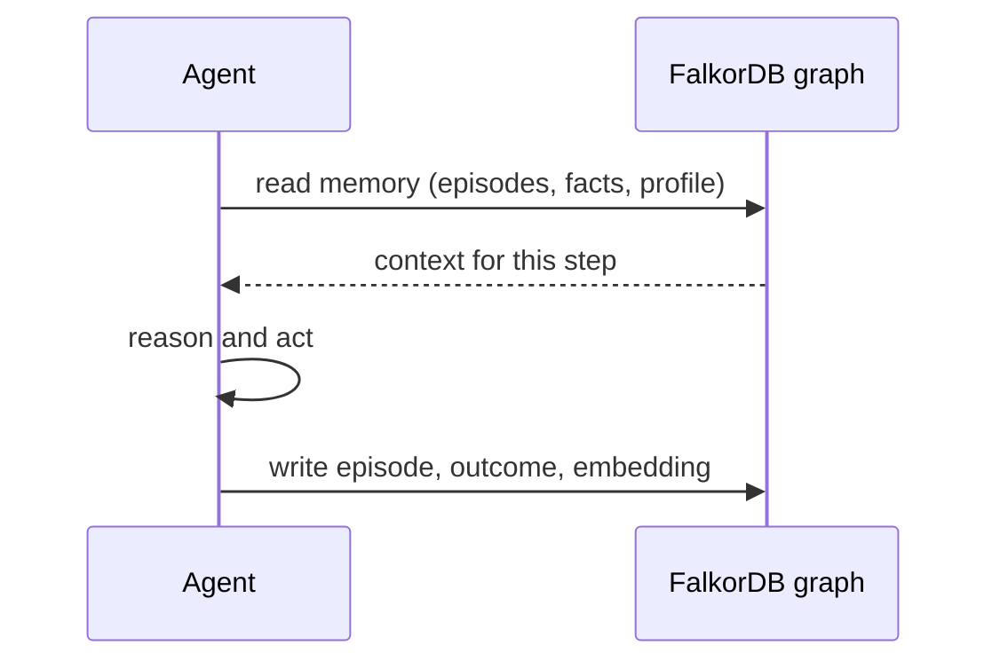
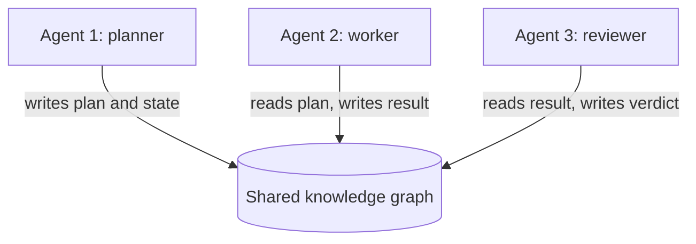

# Agent Memory and Coordination

Agents are only as good as the context they work with. This file covers the hackathon's core theme: giving an agent **memory** that persists and **state** it shares with other agents.

## The problem

- Agents see **pieces, not the whole picture**.
  - They lose track of what happened in earlier sessions.
  - They miss how people, systems, and records relate.
  - They cannot explain why they made a choice.
- Three kinds of memory to think about:
  - **Episodic** - what happened: conversations, events, sessions.
  - **Semantic** - what is true: facts, profiles, entities.
  - **Procedural** - how things are done: skills, learned routines.

## Why memory should be graph-based

- Memory is about connections: this conversation to that user, this fact to that episode, this decision to its outcome.
- A graph stores those connections directly, so memory **persists, updates over time, and is shared** with any agent that needs it.
- Traversals are fast enough to run **on every step of the agent loop**, not only at session start.
- **Multi-tenancy** keeps memories isolated: one instance, one graph per user or tenant, no separate deployments.



## A practical pattern (QueryWeaver)

- An open-source demo app converts natural language to SQL, runs the query, and answers in natural language.
- Around that agent, the app stores its own working memory in a graph.
  - User question, generated SQL query, success or failure, error, timestamp, and an embedding for semantic search.
  - These are connected with relationships, so past experience is one hop away.
- On new questions, the agent retrieves relevant past queries and facts to inform the next one.
- Takeaway: decide **what the agent needs to remember** and **how it will store it**, then connect everything.

## A lighter pattern (Blast Radius)

- **Write findings back**: memory is just more nodes - no separate store:

```cypher
CREATE (f:Finding {text: $text, at: $at, session: $session})-[:ABOUT]->(:Service {name: $name})
```

- **Read before you reason**: query earlier findings about the same entity first, and return `at` with the text so old and fresh memories keep different weight.
- **Isolate per tenant**: `db.select_graph(f"ops:{tenant_id}")` gives every user or tenant a graph no other query can reach.

## Temporal knowledge graphs (Graphiti)

- Graphiti builds **temporal knowledge graphs**: facts carry validity windows, so the system knows what is current and what is outdated.
- This addresses a known weakness: if you merge new facts forever without tracking time, the graph fills with conflicting, superseded information.
- FalkorDB integrates with Graphiti, Cognee, LangChain, and LlamaIndex, all of which use graphs for agent memory.

## Keeping context fresh (CocoIndex)

- CocoIndex is a Rust-based data transformation engine for AI systems.
- You declare a state transition in Python; it renders the result into a target such as FalkorDB, a vector store, or a relational database.
- Its core is a **persistent pipeline**: caching, pipeline catalog, version tracking, and lineage.
  - Change one file and only affected data is refreshed, so agent context stays fresh without full rebuilds.
- FalkorDB has a connector for it.

## Multi-agent coordination



- **Shared state**: agents read and write the same graph; a handoff is just a relationship.
- **Concurrency**: FalkorDB handles high-concurrency reads and writes, so parallel agents are fine.
- **Isolation**: per-user or per-tenant graphs prevent memory leaks between agents.
- **Traceability**: every answer can point to the path it followed. That is what "decisions you can trace" means in the hackathon brief.

Memory is a graph your agent reads at the start of every step and writes to at the end. Everything else in this file is a decision about what goes in it, how fresh it stays, and who can see it.
