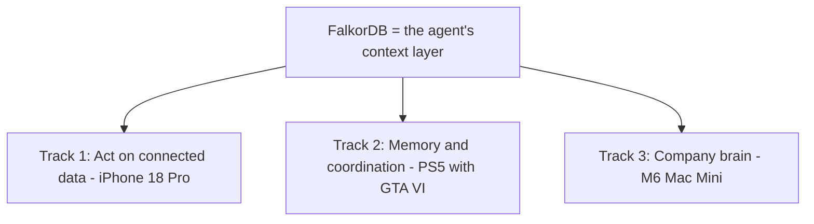
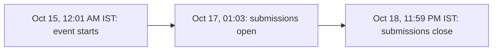

# Hackathon Playbook

Compliance and winning for **Graph Hacks: Context for AI Agents**, powered by FalkorDB.

## The challenge

- **Build** a working agent (or a group of agents) with **FalkorDB as its context layer**.
- **The hard rule**: the graph must shape what the agent does. FalkorDB must be the primary graph database and support a central part of the product; if the product still works with FalkorDB removed, the graph is decoration.
- **What the work must do**: follow connections, remember across sessions, share state between agents, connect people, projects, and decisions, and show the path behind an answer.

## Tracks and prizes



- **Track 01 - Agents That Act on Connected Data**: the graph drives decisions and actions (fraud investigation, security triage, codebase work).
  - Focus: multi-hop reasoning, graph queries and algorithms as agent tools, tool selection through MCP, actions based on what the graph shows, explainable results.
  - Prize: iPhone 18 Pro.
- **Track 02 - Agent Memory and Coordination**: agents remember across sessions and share state with each other.
  - Focus: episodic, semantic, and procedural memory; persistent conversation history; shared state and handoffs; high-concurrency reads and writes; separate memory per user or tenant.
  - Prize: PS5 with GTA VI.
- **Track 03 - Company Brain**: one graph of people, teams, projects, documents, and decisions.
  - Focus: knowledge from docs, tickets, and chats in one graph; who owns what and who knows what; tracing decisions to their source; keeping knowledge current; answers with clear sources.
  - Prize: M6 Mac Mini.
- **Side prizes**: AirPods 5 for the best blog post; top 50 teams get everyone a T-shirt.
- Enter one, two, or all three tracks; every winning-team member gets the prize.

## Key facts

- **Dates**: Oct 15, 12:01 AM to Oct 18, 11:59 PM IST (GMT+5:30).
- **Where**: online, from anywhere. Free to enter.
- **Teams**: solo or up to 4 people. 7,671 registered. Team `cto-ai`, team code `25F934`.
- **Submissions open** Oct 17, 01:03; your team is locked after submitting.
- **No experience needed**: the getting started guide covers basics; use any language or stack.



## Rules to respect

- **New work**: general libraries and templates are fine, but the submission and its main FalkorDB implementation must be built during the event. Notes, graph-model sketches, and diagrams may be prepared beforehand.
- **Coding assistants are allowed, but they must be disclosed**; you must understand the code and explain the graph model, queries, and architecture. Fully AI-generated work may be rejected.
- **Submission pack**: public repo, README with setup and graph model, the Cypher queries or algorithms the product depends on, a demo video, a live deployment or complete local setup, and every track you enter.
- **Data**: public, synthetic, or your own only - do not load private or paywalled data.

## Build checklist

- **Pick a connection question**, for example "Which accounts are linked to this flagged transaction?"
- **Model the graph first**: decide nodes, relationships, and properties before writing app code.
- **Run FalkorDB**: Docker one-liner or a Cloud free instance.
- **Give the agent tools**: Cypher queries, graph algorithms, and/or the GraphRAG SDK, exposed through MCP where useful.
- **Add memory**: save episodes, facts, and outcomes; let the agent read them in the next session.
- **Trace everything**: keep the path from question to answer for the demo.
- **Write the blog post**: it is a separate side prize and doubles as your demo script.

```cypher
MATCH (p:Person)-[:WORKED_ON]->(:Project)-[:USES]->(s:System {name: $system})
RETURN p.name AS person, count(*) AS projects
ORDER BY projects DESC
LIMIT 5
```

- The query above is the event's own example of "who knows about this system" - a good test for your graph model.
