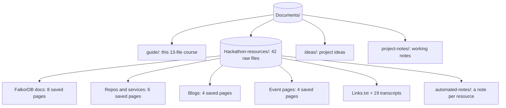

# Resources Map

The course and the resources sit together under `Documents/`:

```
Documents/
├── guide/                 this 13-file course
├── Hackathon-resources/   42 raw files (docs, transcripts, links)
│   └── automated-notes/   one processed note per resource + index
├── ideas/                 hackathon project ideas
└── project-notes/         working notes while building
```



## What to open when you are stuck

- **Setup and first queries** - `Getting Started with FalkorDB...mhtml`, then the documentation home page.
- **Docker and deployment** - `Deploy FalkorDB with Docker and Docker Compose...mhtml`.
- **Visual debugging** - `FalkorDB Browser...mhtml`, plus the Browser itself on port 3000.
- **Code and repos** - `FalkorDB Client Libraries...mhtml`, the FalkorDB GitHub page, the GraphRAG-SDK GitHub page, and the benchmark GitHub page.
- **Query language** - `Cypher Query Language Reference...mhtml`.
- **Analytics** - `Graph Algorithms in FalkorDB...mhtml`.
- **AI design** - `What is GraphRAG...mhtml`, the GraphRAG SDK repo, and the community projects page.
- **Cloud** - the sign-in and sign-up pages, plus the four transcript walkthroughs for Free, Startup, Pro, and Enterprise tiers.
- **Event rules** - `Graph Hacks_ Context for AI Agents _ WeMakeDevs.mhtml` (tracks, prizes, FAQ), plus the Rules, Resources, and Submit pages and the WeMakeDevs "How to Build an Agent That Reasons Over a Graph" tutorial.
- **Deep dives** - the 19 `Transcript*.txt` webinar transcripts.
- **Processed notes for everything** - `Hackathon-resources/automated-notes/README.md` (one detailed note per resource, each linked to its source).
- **All links in one place** - `Links.txt`.

## The full collection at a glance

- **FalkorDB docs (8 saved pages)**: documentation home, getting started, Docker deployment, Browser, client libraries, integrations, Cypher reference, graph algorithms.
- **Repos and services (6)**: FalkorDB GitHub, GraphRAG-SDK GitHub, benchmark GitHub, Docker Hub image, Cloud sign-in, Cloud sign-up.
- **Blogs (4)**: FalkorDB vs Neo4j benchmarks, What is GraphRAG, community projects, and the WeMakeDevs agent-building tutorial.
- **Event (4)**: the WeMakeDevs hackathon page, Rules, Resources, and the Submit form.
- **Lists and transcripts (20)**: `Links.txt` plus 19 webinar transcripts.

## Transcript topics (for when you need depth)

- **Cypher performance** (2 files) - writing efficient queries with PROFILE and indexes.
- **Agent memory** (3 files) - agentic memory, QueryWeaver, and the fifth and sixth "Graph & RAG" installments with knowledge graph demos.
- **GraphRAG SDK 1.0** - the deep dive on why RAG fails and what the SDK changes.
- **Cloud tiers** (4 files) - Free, Startup, Pro, and Enterprise instance walkthroughs.
- **Security analytics** - graph algorithms for cyber security and ransomware spread (2 files).
- **UDFs** - user-defined functions with a form-to-table use case.
- **Natural language to SQL/Cypher** - LLM-based text-to-query approaches.
- **Snowflake app** (2 files) - graph analytics inside Snowflake with zero ETL.
- **Cluster and multi-tenancy** - scale-out workshop.
- **AMA** - new algorithms like Minimum Spanning Tree, built with sparse linear algebra.
- **Context for agents** - the CocoIndex interview on fresh context pipelines.

## How this guide maps to the resources

- **Foundation files** (`01`, `02`) come from the docs home, getting started, and the GitHub READMEs.
- **Hands-on files** (`03` to `06`) come from the Docker, Browser, clients, Cypher, and UDF resources plus the performance transcripts.
- **AI files** (`07`, `08`) come from the GraphRAG blog, the GraphRAG SDK repo, and the SDK deep dive.
- **Agent files** (`09`, `10`) come from the algorithms docs and the memory and security transcripts.
- **Project files** (`11`, `12`) come from the WeMakeDevs event pages (main page, Rules, Resources, Submit) and the WeMakeDevs agent tutorial, plus this whole collection.

When in doubt, search the transcripts folder for your topic. Almost every beginner question in this guide has a full workshop hour behind it in the raw resources.
