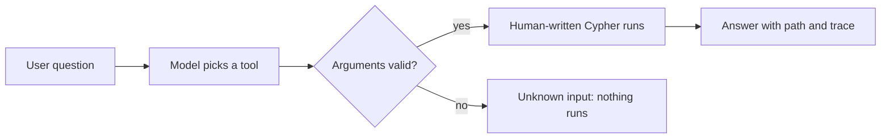

# Agent Tools and MCP

An agent needs a safe way to ask the graph questions. The pattern that works: a **fixed tool catalogue** - humans write the queries, the model picks a tool and fills in arguments, and every argument is checked before anything runs.



## Why the agent should not write Cypher

- The obvious design is to hand the model the schema and let it generate queries.
- It demos well on the first question and fails in three ways.
  - It writes queries that are subtly wrong in ways nobody notices.
  - It writes queries expensive enough to hurt.
  - When someone asks why an answer came out that way, there is nothing to show except a query the model has already forgotten.
- The alternative: give the agent a catalogue instead - each tool has a human-written query and a typed signature.

## A fixed tool catalogue

- Six tools from the event tutorial's on-call agent (Blast Radius), each with typed arguments:

```python
TOOLS = {
    "blast_radius":   {"args": {"service": "service_name", "depth": "int<=4"}},
    "who_to_wake":    {"args": {"service": "service_name", "depth": "int<=4"}},
    "recent_changes": {"args": {"service": "service_name", "hours": "int<=168"}},
    "path_between":   {"args": {"from": "service_name", "to": "service_name"}},
    "load_bearing":   {"args": {"limit": "int<=20"}},
    "recall":         {"args": {"service": "service_name"}},
}
```

- The argument types are not documentation - they are checked.
- A service name is resolved against the graph, not against a regular expression:

```python
def resolve_service(graph, name: str) -> str | None:
    rows = graph.ro_query(
        "MATCH (s:Service {name: $name}) RETURN s.name AS name",
        {"name": name},
    ).result_set
    return rows[0][0] if rows else None
```

- A name that does not resolve produces an "unknown service" outcome, and nothing else runs.
- No model-produced string is ever concatenated into a query, which closes the injection question completely.
- The same check removes a whole category of demo failure: the model reasoning about `payment-service` when the graph calls it `payments-api`.

## Expose the tools over MCP

- **MCP** (Model Context Protocol) is how the agent sees the catalogue: the model selects and fills arguments instead of composing queries.
- Tool selection through MCP is one of the listed foci of Track 01, and a FalkorDB MCP server already exists.
- Algorithms belong in the same catalogue: wrap `CALL algo.<name>()` procedures as tools - shortest path, PageRank, communities - and the agent can route, rank, or cluster without writing a traversal.
- Let every tool return the path with its answer, so the explanation comes from the query rather than from the model afterwards.

## Keep the trace

- Have the app print a trace: the tool, its arguments, how long it took, and how many rows came back.
- That turns "the agent reasoned over the graph" into something a demo audience can check.

## Rules of thumb

- Fix the queries, parameterize them, and let the model choose between them rather than compose them.
- Validate names against the database before reasoning about them.
- Keep the catalogue small and typed; every extra tool is another choice the model can get wrong.
- Return the path with the result - the query already walked it.

A tool catalogue is the difference between an agent that guesses at the graph and one that asks it precise, safe questions. Build the catalogue first, and the rest of the agent becomes plumbing.
