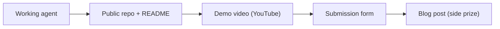

# Demo and Submission

The build is finished when the demo shows judges something no other database could have done. This file covers what judges look for, the demo moves that land, and the submission pack.



## What judges look for

- **Does the graph do real work?** The event's own test: if the product still works with FalkorDB removed, the graph is decoration.
- A project where the graph is a store the agent occasionally reads from is one any database could have served, and that reads immediately.
- The strongest demo move: **run the same question twice**.
  - Depth 1 returns the obvious, directly-upstream services - something a join could have done.
  - Depth 4 picks up a dependency three hops away that nobody knew about, and the path explains why it is there.
  - The contrast takes about fifteen seconds and makes the argument for the whole category.

```cypher
MATCH path = (upstream:Service)-[:DEPENDS_ON*1..$depth]->(s:Service {name: $name})
RETURN DISTINCT upstream.name AS service, length(path) AS hops,
       [n IN nodes(path) | n.name] AS via
ORDER BY hops, service
```

- The second move: **ask something that is not in the graph** and let the agent say so.
  - "Nothing in the graph connects to this service" is more convincing than an agent that always has an answer.
- **Put the hops on screen** next to every result. A list of names is a claim; the same list with `checkout-web → cart-service → payments-api` under it is something an engineer can agree or disagree with in two seconds.

## The submission pack

- Every submission must include six things, per the event rules.
  - A public source-code repository.
  - A README with setup instructions and your graph data model.
  - The Cypher queries or graph algorithms the product depends on.
  - A demo video showing the working project.
  - A live deployment, or complete local setup instructions.
  - The track you are entering.

## The submission form

- The form has eight questions in two parts: **Project Details** (six) and **Feedback** (two).
- Project Details: title, description, track selection, repository, demo video, live demo link, "How did you use FalkorDB?", and an optional blog link.
- The demo video must be a YouTube link, kept public or unlisted.
- Feedback asks what you liked about FalkorDB and what to improve.
- The form stays editable until the deadline: **Oct 18, 11:59 PM IST**.
- Disclose AI coding assistants, and be ready to explain the graph model, the queries, and the architecture.

## The blog post (side prize)

- The best blog post wins **AirPods 5**; the top 50 teams get a T-shirt for every member.
- Write about the problem, the graph model, and what you learned - it doubles as your demo script.

## Final checklist

- Repository public, README complete: setup plus the graph data model.
- Video up and accessible, showing the path behind an answer.
- Queries and algorithms listed where judges can find them.
- Deployment live, or local setup steps tested from a clean machine.
- Every track you are entering named.
- Submit early; the form can be edited until the deadline.

The demo is not an app tour. It is one question that a database without relationships cannot answer, answered with its path visible on screen.
