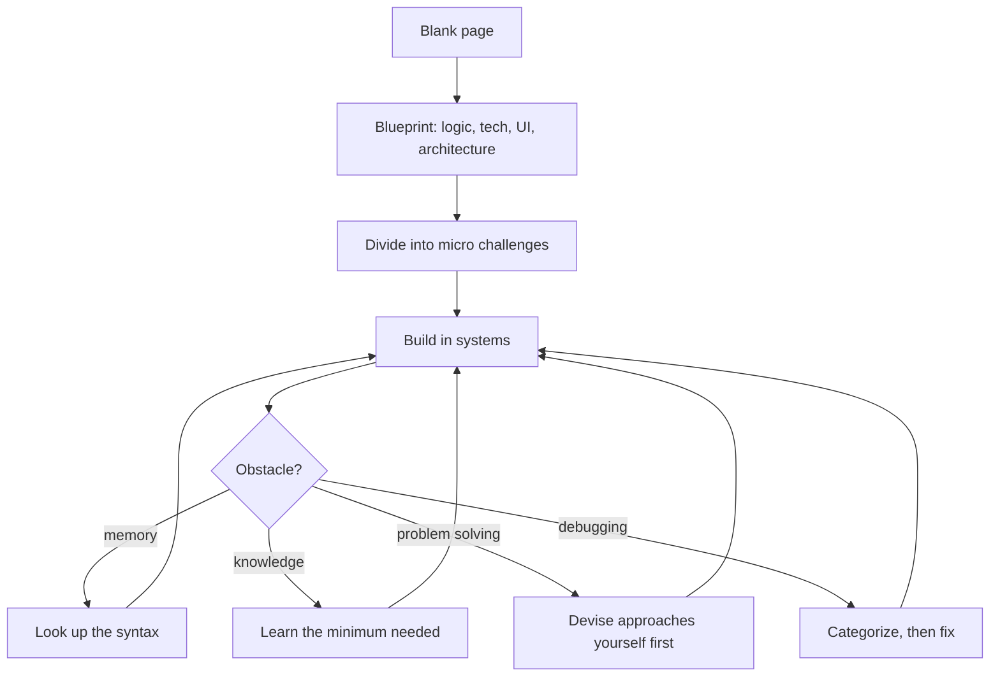

# Building From Scratch

A project that does not exist yet is a blank page. This file distills a working developer's on-camera build — idea to deployed full-stack app — into three strategies that fit a hackathon weekend as well as a side project.

## Strategy 1: Blueprint before code

- Instead of debating whether to start, **research, plan, and develop a complete architectural blueprint** of the build first.
- The blueprint steps, in order:
  - Finish the design of the core logic.
  - Research and pick the technologies.
  - Create the UI/UX in Figma.
  - Design the system architecture - backend and database.
  - Write the core algorithm.
  - Revise all the technologies required before opening the code editor.
- The claimed payoff: a blueprint makes development **at least 10x easier and much faster**, and the plan itself creates the small challenges that keep momentum up.

## Strategy 2: Divide everything

- A massive project is only overwhelming as a whole: **divide it into smaller, doable micro challenges**.
- A development order that works:
  - Backend endpoints and core logic first.
  - Then the database and the rest of the backend.
  - Then authentication.
  - Then dynamic links and page functionality.
  - Frontend last - it is much easier once the backend exists.
- Divide again when a piece is still big: a landing page becomes a background, some text, a button, and one exported graphic.

## Strategy 3: Work in systems

- When an obstacle appears, ask **what kind of problem it is** before fixing it.
  - **Memory problem** ("I do not remember the syntax")? Look it up. Memorization is not engineering.
  - **Knowledge problem** (you have never done this)? Learn the minimum needed for the current challenge only.
  - **Problem-solving challenge** (how should this API be designed)? Come up with approaches yourself first, and only then seek help.
  - **Debugging problem** (why is this error appearing)? It is usually one of the three above; categorize it, then fix it.

## Use AI as a search engine

- The video's rule: use the assistant the way developers once used search - **a search engine, not a replacement for your brain**.
- That matches the event rules: assistants are allowed, their use must be disclosed, and you must understand everything you submit.
- Two habits that carried the build: read the documentation first for every new technology, and when CSS fights a visual, export the asset from the design tool instead.

## What the example build shows

- Project: a gamer personality test - six archetypes scored from quiz answers, plus a hidden seventh near the graph's origin.
- Algorithm: **weighted vector scoring** (every answer adds weights; the highest trait wins), opposite traits sharing one spectrum, and three axes arranged as a hexagon whose averaged coordinates place the result on a graph.
- Architecture: three endpoints (results, shared-link fetch, authentication) and two tables (`results`, `users`).
- The build hit every classic failure - a broken install, undefined properties, a wrong endpoint the AI suggested - and the system above is what resolved each one.

Blueprint first, divide until every piece is obvious, and label every obstacle as memory, knowledge, problem solving, or debugging. The full walkthrough is in `Transcript copy 19.txt` in the resources folder.
